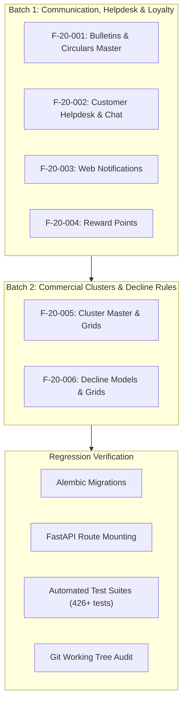

# PHASE 20 — COMPLETE PROJECT MIGRATION EXECUTION PLAN

**Repository**: `Reliable-Insurance-Backend`
**Branch**: `tejas-feature`
**Baseline Commit**: `a00899c4af29f1393de6b7ab5c5f4a41579ffdd9`
**Legacy Reference Source**: `./InsurancefinalNew_2026_09_23/InsurancefinalNew/` (`4,792` files; `UNTRACKED / READ-ONLY`)
**Active Development Database**: `reliable_insurance_dev`
**Baseline Database State**: `82 physical tables` at Alembic head `b18a0c5d1801`
**Baseline Route State**: `308 app.routes` (`304 APIRoute` endpoints + `4 OpenAPI/Docs`)
**Baseline Test Suite**: `426 / 426 PASSED` in `140.48s`
**Target Goal**: Complete, evidence-grounded functional migration of all remaining meaningful legacy capabilities discovered in the full source inspection.

---

## 1. Executive Mission & Scope Expansion

While previous migration phases (Phases 1 through 19B) achieved complete implementation of the **120 Canonical Logical Features (`F-17B-001` through `F-17B-120`)**, full source inspection of the 4,792 legacy files—including 147 classes in `BLL_Operations.cs`, 146 classes in `DAL_Operations.cs`, 284 active WebMethods in `Service.asmx.cs`, and 621 ASP.NET WebForms code-behind pages (`.aspx.cs`)—revealed specific operational and master-data capabilities that were previously considered auxiliary UI features or consolidated under broader umbrellas, but possess distinct backend database and business workflows.

Phase 20 executes the migration of these remaining meaningful legacy capabilities into the modernized FastAPI architecture, grouped into dependency-aware, tested implementation batches.

---

## 2. Full-Scope Legacy Inventory & Gap Classification

The comprehensive source audit of all 147 BLL classes, 1,776 unique stored procedure references, and 621 WebForms code-behind pages identified the following classification:

| Feature ID | Functional Domain | Legacy Source Evidence | Business Capability | Target FastAPI Architecture | Status |
|---|---|---|---|---|:---:|
| **`F-20-001`** | Admin & Communications | `BLL_Circular`, `DAL_Circular`, `adm_Circular.aspx.cs`, `Sp_CircularOperation`, `SelectCircluarPdfPath` | **Company Bulletins & Circulars Master**: Broadcast official underwriting circulars and notices with PDF attachment to portal users. | `tbl_circular`, `Circular` model, `/api/v1/admin/circulars` CRUD | **BATCH 1** |
| **`F-20-002`** | CRM & Helpdesk | `BLL_CustomerHelp`, `API_AppchatBorad`, `adm_ChatSelect.aspx.cs`, `Service.asmx.cs::InsertCustomerHelp`, `Sp_ViewAppChat` | **Mobile Customer Helpdesk & Support Chat** (`F-17B-050`): Inbound helpdesk inquiries, message threads, coordinator replies, registration linking. | `tbl_customerhelp`, `tbl_chatboard`, `/api/v1/renewals/customer-help/*` | **BATCH 1** |
| **`F-20-003`** | Alerts & Notifications | `BLL_WebNotification`, `DAL_WebNotification`, `adm_WebNotification.aspx.cs`, `sp_insertWebNotification` | **Web Notification Alerts Master**: In-app popups and banner alerts for portal operators and agents. | `tbl_webnotification`, `WebNotification` model, `/api/v1/admin/web-notifications` | **BATCH 1** |
| **`F-20-004`** | Partner Incentives | `BLL_RewardPoint`, `DAL_RewardPoint`, `adm_MyPointReport.aspx.cs`, `sp_AppSelectRewardPoint` | **Partner Loyalty & Reward Points**: Customer referral and partner performance reward points balance tracking and ledger. | `tbl_rewardpoint`, `RewardPoint` model, `/api/v1/agents/reward-points` | **BATCH 1** |
| **`F-20-005`** | Commercial Masters | `BLL_ClusterMaster`, `DAL_ClusterMaster`, `adm_ClusterMaster.aspx.cs`, `adm_ClusterWiseAgentGrid.aspx.cs`, `adm_ClusterWiseBrokerGrid.aspx.cs` | **Geographic Cluster Master & Commission Grids**: Grouping RTOs by insurer/state into commercial clusters and setting broker/agent rates by cluster. | `tbl_clustermaster`, `tbl_clusterdetails`, `tbl_clusterwisebrokergrid`, `tbl_clusterwiseagentgrid` | **BATCH 2** |
| **`F-20-006`** | Underwriting Rules | `adm_BrokerCommDeclineModel.aspx.cs`, `adm_GridDeclineScreen.aspx.cs`, `sp_DeclineModel_2025`, `sp_InsertGriddeclinemaster` | **Decline Models & Restrictions Grid**: Managing vehicle models, fuels, and RTOs excluded from brokerage commissions or underwriting. | `tbl_declinemodel`, `tbl_griddecline`, `/api/v1/masters/decline-models` | **BATCH 2** |

---

## 3. Honest Resolution of the Six UNKNOWN Feature Groups

In accordance with strict safety policy:
- Direct queries or connections to the production database `brahmainsurance` (`103.76.254.139`) are strictly forbidden.
- No synthetic stored procedure logic or imaginary database routines may be fabricated.
- Unextracted routine bodies (`F-17B-114` through `F-17B-117`, `F-17B-119`) and unreferenced catalog tables (`F-17B-120`) remain preserved as **`UNKNOWN (Database-Only)`**.
- Their known parameter signatures and C# DAL contracts remain fully implemented in Python services without claiming fabricated line-by-line SQL parity.

---

## 4. Phase 20 Execution Sequence

---

## 5. Acceptance Criteria per Batch

For every batch:
1. **SQLAlchemy Declarative Models**: Defined in `app/models/` using standard SQLAlchemy 2.0 type-annotated mappings with table prefixes (`tbl_`).
2. **Pydantic v2 Schemas**: Defined in `app/schemas/` with strict type validation, field constraints, and `extra="forbid"`.
3. **Async Service Layer**: Implemented with explicit database session dependency, error handling, and authorization scoping.
4. **FastAPI Endpoints**: Mounted with clear tags, response models, and OpenAPI docstrings.
5. **Database Migration**: Created via Alembic revision with deterministic upgrade and downgrade functions.
6. **Automated Test Coverage**: Comprehensive unit and integration tests verifying HTTP status codes, schema contracts, database persistence, and side effects.
7. **Zero Regression**: All existing 426 tests must continue to pass without errors or regressions.
